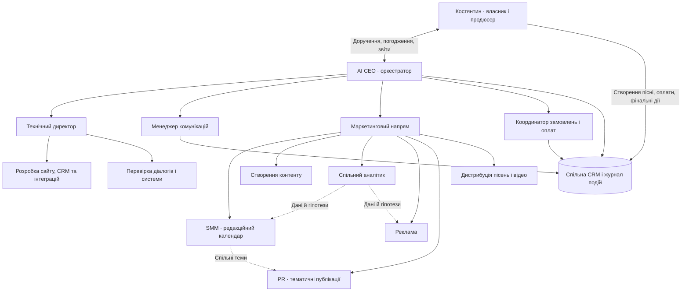

# Подаруй пісню 2.0 — карта віртуального офісу та інструкція побудови

Архітектурна пропозиція за узгодженнями 28 жовтня 2026. Це план реалізації: створення документа не запускає агентів, інтеграцій, розсилок чи реклами.

## 1. Де що живе

**Рекомендація:** розробляємо в наявному проєкті Codex; обговорення, голосове планування й оцінка стилю можливі в цьому чаті. Робочий бізнес-офіс запускаємо як окремий серверний застосунок зі своєю CRM, API моделей, обробкою подій, збереженням стану та контрольованими діями.

| Місце | Призначення | Що це не означає |
|---|---|---|
| Цей чат / ChatGPT | Бачення, рішення власника, розбір діалогів і творчих прикладів | Повідомлення в чаті самі не створюють постійно працюючу компанію агентів |
| Codex + наявний репозиторій | Реалізація, перевірка коду, інструкції ролей, інтеграції, тести | Окремий чат на кожного агента не заміняє спільну пам’ять і чергу задач |
| Постійний сервер | Робочі агенти, події, розклади, інтеграції, контроль дозволів | Поточний локальний ноутбук не забезпечує роботу незалежно від його стану |
| CRM / майбутній розділ «Офіс» | Замовлення, задачі, діалоги, файли, погодження, звіти та витрати | Цей розділ ще потрібно створити |
| Приватний керівницький Telegram | Спілкування власника з CEO, звіти та запити погодження | Окремий від клієнтського бота контекст і права доступу |
| Клієнтські канали | Сайт, Telegram, далі Instagram; інші за потреби | Наявність посилання не означає, що API каналу підключений |

Практичний старт: продовжуємо Next.js/TypeScript-проєкт song-system без переписування готового інтерфейсу. Серверний шар агентів відокремлюємо від бізнес-правил і адаптерів каналів. Конкретний agent runtime та хостинг вибираємо перед реалізацією за збереженням стану, тестуванням, доступними каналами й вартістю. OpenAI Agents SDK — один із задокументованих варіантів інтеграції агентів у власний застосунок; це не факт, що SDK вже встановлено. Міграцію на новий фреймворк цим документом не запускаємо.

Розміщення першого пілота: постійний сервер/контейнер для застосунку та worker, стійка база, приватне файлове сховище, резервні копії й HTTPS. Перед перенесенням прибираємо залежність від локального SQLite через перевірену міграцію; наявний LOCAL_ONLY захист не обходимо. Провайдера й бюджет погоджуємо за окремим кошторисом, без купівлі зараз.

## 2. Карта команди — цільова структура

Ролі не обов’язково означають окрему постійно активну модель. Спочатку CEO, менеджер і перевіряльник; решта — поступове підключення. Можна мати спеціалізовані інструкції й інструменти в одному runtime. Маркетинг — напрям, не обов’язково додатковий керівний агент.

## 3. Функції та межі

| Роль | Робить | Межі |
|---|---|---|
| Власник / продюсер | Підтверджує платежі; створює текст і пісню в Suno; перевіряє MP3, обкладинку й теги; погоджує фінальне відправлення; вирішує скарги | Фінансові перекази та рішення про повернення виконуються людиною |
| CEO | Перетворює доручення на задачі, призначає ролі, визначає метрики, перевіряє звіти й витрати, узгоджує щоденний план | Не розширює власні повноваження, не додає нові платні сервіси/доступи, не збільшує бюджет без власника |
| Техдиректор | Об’єднує сайт, CRM і канали; організовує розробку й перевірки | Дизайн і приймання — власником; доступ до клієнтських даних лише за необхідністю |
| Менеджер | Збирає бриф, відповідає, погоджує відомі умови, показує погоджені реквізити | Не вигадує факти, тарифи, строки, людей чи підтвердження оплат; передає складні випадки продюсеру |
| Перевіряльник | Проганяє приймальні діалоги, звіряє правила та фактичні зміни CRM | Не може сам схвалити власний неперевірений результат як приймання власником |
| Координатор замовлень | Черга, дедлайни, стан брифу, версії, раунди правок, залишок оплати | Не підтверджує платіж за квитанцією або минулим часом |
| SMM | План на 1–2 місяці, теми, приводи, задачі на пісні | Не обіцяє публікації неготових матеріалів, дати свят перевіряє |
| Контент | Сценарії, тексти, обкладинки, фрагменти та відео | Тільки дозволені до публікації матеріали; AI-сцени не називає реальними реакціями клієнтів |
| Аналітик | Контент, охоплення, рекламу, звернення, оплати, гіпотези | Не вигадує відсутні дані; відокремлює атрибуцію від припущень |
| Реклама | Готує/виконує кампанії за дозволами, бюджетами й правилами зупинки | На старті матеріали й запуск погоджує власник; бюджет не збільшується самовільно |
| PR | Тематичні статті та добір майданчиків за спільним календарем | Від імені бренду, без фальшивих рекомендацій і гарантій позицій Google/AI |
| Дистрибуція | Адаптація пісень для YouTube, Shorts, інших підключених майданчиків; описи та доречні посилання | Погодження матеріалів, права на публікацію, реально доступні API/умови сервісів |

## 4. Як агенти взаємодіють

Доручення власника → задача CEO → призначення виконавцю → виконання через дозволені інструменти → перевірка → погодження, якщо потрібне → дія → фактичний результат → звіт CEO.

У задачі: мета, джерело доручення, виконавець, контекст/посилання на замовлення, дозволені дії, бюджет, строк, критерій готовності, результат і історія рішень. Стани: нова / у роботі / очікує дані / очікує власника / на перевірці / завершена / помилка.

Повідомлення клієнта — дані для менеджера, а не нові повноваження для CEO. Доступи, відправки, виплати та бюджет перевіряються кодом. CEO обирає лише з дозволеного каталогу моделей і ролей. Для нової ролі готує опис, інструменти, бюджет і тест; на старті активацію погоджує власник. Дешевші моделі — для простих перевірених задач, складніші — для неоднозначних; вибір остаточно визначаємо тестами. Безлімітних циклів самоделегування немає.

Кожна зовнішня дія має захист від повторного виконання. Помилка або перезапуск не повинні дублювати повідомлення, публікацію чи платіжну задачу. Одна активна сторона діалогу: після передачі продюсеру помічник мовчить до повернення керування.

## 5. Де власник бачить офіс

Майбутні розділи CRM:
- **Сьогодні:** черга, дедлайни, питання до власника, залишки оплат.
- **Замовлення:** переписка всіх підключених каналів, бриф, оплати, MP3, правки й доставка.
- **CEO:** чат із керівником, щоденний план, рішення й звіт.
- **Задачі та агенти:** виконавець, дозволи, поточний стан, результат, витрати.
- **Контент:** спільний календар, бібліотека дозволених пісень, публікації й офіційні канали.
- **Погодження:** дизайн, публікації, реклама, нові доступи/ролі, рішення продюсера.
- **Налаштування:** бізнес-умови, версії тону, інтеграції, моделі, ліміти та секрети на сервері.

Telegram керівника — короткі звіти й сповіщення з переходом у CRM. Відповідь власника має записуватися в історію задачі, а не губитися в окремій розмові. Звіти за день, 7 днів і місяць з порівнянням відповідних періодів. Щоденний ритм діє, поки власник його не змінить; розклад ще не активовано.

## 6. Затверджені бізнес-правила

- 2000 грн: 1000 до початку + 1000 після отримання готової пісні або вся сума одразу.
- 1000 грн: повна оплата до початку. Власний текст — після перегляду; військовий формат — за погодженим критерієм.
- До 48 годин після отримання повної інформації; стан оплати ведеться окремо. Пріоритетне виробниче правило: власник починає після необхідної підтвердженої оплати. Суперечність між обіцяним строком та затримкою оплати ескалуємо власнику, не пересуваємо дедлайн мовчки.
- До 5 раундів правок; якщо результат після них не погоджено — повернення всієї фактично сплаченої суми. Виконання повернення — власником.
- Невдоволення отримувача — продюсеру без самостійного рішення менеджера.
- Квитанція не дорівнює підтвердженню надходження; на старті підтверджує тільки власник.
- MP3 надсилається після перевірки й натискання власника. Успішна відповідь каналу фіксує відправлення, але не доводить прослуховування клієнтом.
- Успішне закриття: файл надіслано, результат прийнято, всю суму підтверджено. Оплата, відгук і виконання — окремі стани.
- Немає персонального демо. Тон природний, прозора роль помічника; історичні приклади не змінюють актуальні умови.

## 7. Що вже є, а що будуємо

За оглядом коду є локальний сайт, адмінка замовлень, ручний облік оплат, публічні медіа, сценарний чат, Telegram worker та перенесення контексту. Працездатність процесів на сьогодні цим документом не перевірялася. Поточний worker залежить від локального запуску. Наявний файл токена не розкриваємо.

Ще не реалізовано: повноцінний CEO, автономна команда, єдина панель офісу, вільний AI-діалог, повний контроль передачі людині, канали Instagram/пошти, маркетингові агенти, фінальна доставка приватних MP3, автоматична звітність і постійне серверне розгортання. Наявні інструкції та назви ролей самі не означають працюючі інтеграції.

## 8. Порядок побудови

1. **Закріпити правила.** Цей документ і приймальний чекліст; актуальні умови — окремий версійований конфіг. Власник перевіряє логіку, техдиректор — реалізацію.
2. **Довести менеджера.** Модель розуміння діалогу, структурований бриф, питання/правка/відмова/скарга, передача продюсеру. Власник тестує 20 сценаріїв; критичні помилки блокують запуск.
3. **Завершити CRM замовлення.** Платежі, незалежні стани, 5 раундів, приватні файли, підтверджене відправлення та закриття. Тестовий MP3 й окремий тестовий чат.
4. **Запустити мінімального CEO.** Задачі, погодження, ежедневний звіт, контроль строків; спочатку лише перевірені інструменти й обмежений бюджет. Метрики детально готує CEO.
5. **Перенести пілот на сервер.** Збереження даних, відновлення, секрети, доступи, черга подій, HTTPS, моніторинг і безпечні перезапуски; власник погоджує кошторис. Не вимикати локальний захист заради простого deploy.
6. **Підключати додаткові канали.** Instagram після перевірки акаунта та доступів; не додавати зайві канали до стабільності основного шляху.
7. **Підключити маркетинг.** SMM → контент/аналітика → реклама/PR/дистрибуція. Спільний календар і каталог каналів. Публікації та рекламні запуски спочатку погоджуються.
8. **Пілот і запуск.** Власник приймає дизайн і діалоги, перевіряє реальне тестове замовлення. Домен та публічні входи змінюємо лише після погодженого запуску.

Від власника зараз: оцінки діалогів, пісні, приймання дизайну. Підключення акаунтів, API-доступи, бюджет моделей та хостингу — на відповідному етапі через налаштування, не токенами у чаті.

## 9. Джерела вибору середовища

Звірено з офіційною документацією OpenAI: [Agents: порівняння runtime](https://developers.openai.com/api/docs/guides/agents) і [Codex SDK: програмне керування задачами розробки](https://learn.chatgpt.com/docs/codex-sdk). Розділення «середовище розробки / робочий офіс» — наша архітектурна рекомендація для цього проєкту, не заява про необхідність єдиного постачальника.
